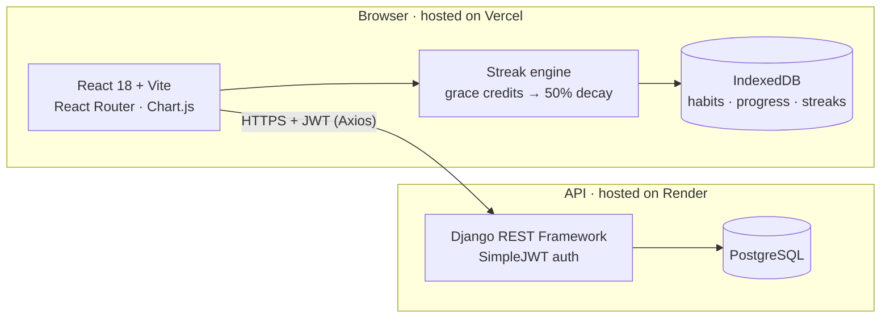

<!--
  ╔══════════════════════════════════════════════════════════════════╗
  ║  YADHAV BALAJI RAO · GitHub profile README                       ║
  ║  Palette  violet #7C5CFF · cyan #00C7FF · gold #F2C94C · ink #0D1117
  ║  Assets   assets/*.svg  (banner, divider, footer — no external host)
  ║  Cards    profile/*.svg (regenerated daily by .github/workflows/profile-cards.yml)
  ╚══════════════════════════════════════════════════════════════════╝
-->

<div align="center">




<p>
  
  
  
  <a href="https://github.com/YBalajiRao?tab=followers"></a>
</p>

<a href="mailto:ybalajirao30@gmail.com"></a>&nbsp;&nbsp;
<a href="https://www.linkedin.com/in/yadhavbalajirao"></a>

<br/>

<b>
<a href="#-about">About</a> &nbsp;·&nbsp;
<a href="#-featured-projects">Projects</a> &nbsp;·&nbsp;
<a href="#-research--publications">Research</a> &nbsp;·&nbsp;
<a href="#-experience">Experience</a> &nbsp;·&nbsp;
<a href="#-tech-stack">Stack</a> &nbsp;·&nbsp;
<a href="#-work-with-me">Collaborate</a> &nbsp;·&nbsp;
<a href="#-lets-connect">Contact</a>
</b>

</div>


## 👋 About

<table>
<tr>
<td width="54%" valign="top">

I'm **Yadhav Balaji Rao** — an AI researcher and full-stack engineer who enjoys the whole journey from **idea → model → product**.

I've taught Computer Science as an **Assistant Professor at Mohan Babu University**, published research on **deep-learning plant-disease detection**, and I ship working software with **React and Django**.

- 🔭 **Building** — deep-learning models for plant-disease detection, and full-stack apps like HabitFlow
- 🌱 **Exploring** — Generative AI and large language models
- 🤝 **Open to** — research collaborations and AI/ML or full-stack roles
- 📍 **Based in** — Madanapalle, India
- 📫 **Reach me** — [ybalajirao30@gmail.com](mailto:ybalajirao30@gmail.com)

</td>
<td width="46%" valign="top">

```python
class YadhavBalajiRao:
    roles    = ["AI Researcher",
                "Full-Stack Engineer",
                "Ex-Assistant Professor"]

    research = ["deep learning",
                "computer vision",
                "plant-disease detection"]

    data     = ["EDA", "data cleaning",
                "visualization"]

    product  = ["React", "Django REST",
                "PostgreSQL"]

    honours  = ["MCA Gold Medal · 8.98"]

    def mission(self):
        return "Research → real impact"
```

</td>
</tr>
</table>

<div align="center">
<table>
  <tr>
    <td align="center" width="25%">🥇<br/><b>8.98 CGPA</b><br/><sub>MCA Gold Medalist</sub></td>
    <td align="center" width="25%">👨‍🏫<br/><b>1 year</b><br/><sub>Assistant Professor · MBU</sub></td>
    <td align="center" width="25%">📄<br/><b>1 paper · 2 talks</b><br/><sub>IJSDR · ICMET '25 · ICACECS '24</sub></td>
    <td align="center" width="25%">🚀<br/><b>Live product</b><br/><sub>HabitFlow · Vercel + Render</sub></td>
  </tr>
</table>
</div>


## 🚀 Featured Projects

### 🎯 HabitFlow — the habit tracker that forgives a bad day

<p>
  <a href="https://habitflow-frontend.vercel.app"></a>
  <a href="https://github.com/YBalajiRao/habitflow-frontend"></a>
  <a href="https://github.com/YBalajiRao/habitflow-backend"></a>
</p>

Most habit apps reset your streak to **zero** after one missed day — punishing you at exactly the moment you need encouragement. HabitFlow uses an **anti-fragile streak model**: a missed day first spends a *grace credit*, and only when those run out does the streak **decay by half — it never hard-resets**.

<table>
  <tr>
    <td width="33%" valign="top">🛡️ <b>Anti-fragile streaks</b><br/><sub>Grace credits first, then 50% decay — never a reset to zero</sub></td>
    <td width="33%" valign="top">📶 <b>Offline-first</b><br/><sub>Habits, progress and streaks live in IndexedDB on your device</sub></td>
    <td width="33%" valign="top">🔐 <b>JWT authentication</b><br/><sub>Email sign-in with access and refresh tokens</sub></td>
  </tr>
  <tr>
    <td valign="top">📊 <b>Insights dashboard</b><br/><sub>Chart.js trends and completion analytics</sub></td>
    <td valign="top">📅 <b>Calendar view</b><br/><sub>Day-by-day progress at a glance</sub></td>
    <td valign="top">🎮 <b>Gamification</b><br/><sub>XP, levels and achievements</sub></td>
  </tr>
  <tr>
    <td valign="top">🧠 <b>Smart coaching</b><br/><sub>Rule-based tips drawn from your own patterns</sub></td>
    <td valign="top">📈 <b>Incremental goals</b><br/><sub>Progress bars for partial completion</sub></td>
    <td valign="top">💾 <b>Your data, portable</b><br/><sub>One-click JSON backup and export</sub></td>
  </tr>
</table>

<details>
<summary><b>🏗️ Architecture</b> — how the pieces fit together</summary>
<br/>



**The streak rule, in four lines** (`src/services/streakEngine.js`):

```js
if (completed)               streak += 1                       // keep building
else if (graceRemaining > 0) graceRemaining -= 1               // the day is forgiven
else                         streak = Math.floor(streak * 0.5) // decay, never reset
// streak health = 50% grace remaining + 50% streak length (capped at 30 days)
```

</details>

<details>
<summary><b>⚡ Quick Start</b> — run HabitFlow locally in about 5 minutes</summary>
<br/>

**1 · Backend** (Python 3.11)

```bash
git clone https://github.com/YBalajiRao/habitflow-backend.git && cd habitflow-backend
python -m venv .venv && source .venv/bin/activate          # Windows: .venv\Scripts\activate
pip install -r requirements.txt dj-database-url whitenoise gunicorn
export DEBUG=True                                           # no DATABASE_URL → SQLite is used
python manage.py migrate && python manage.py runserver      # → http://127.0.0.1:8000
```

**2 · Frontend** (Node 18+)

```bash
git clone https://github.com/YBalajiRao/habitflow-frontend.git && cd habitflow-frontend
npm install && npm run dev                                  # → http://localhost:3000
```

> [!TIP]
> The frontend talks to the hosted API by default. To use your local backend, set `API_URL` in `src/services/api.js` to `http://127.0.0.1:8000/api`.

</details>

<br/>

<table>
<tr>
<td width="50%" valign="top">

### 🍃 Tomato Leaf Disease Detection

<sub>Hybrid deep-learning pipeline · presented at ICACECS 2024</sub>


- **GANs** for data augmentation — more training variety from limited leaf images
- **Super-resolution** to sharpen low-quality field photos
- **Capsule Networks** for features that keep spatial relationships
- Dynamic preprocessing and normalisation for robust classification
- Aim: earlier, more reliable diagnosis for farmers

</td>
<td width="50%" valign="top">

### 📈 Market Trends Analysis

<sub>Exploratory analytics and visual storytelling</sub>


- Collects, cleans and preprocesses large raw datasets
- Exploratory data analysis to surface patterns and trends
- Clear charts that turn findings into a story
- Data-backed insights for better decisions
- Reusable Python analysis workflow

</td>
</tr>
</table>


## 🔬 Research & Publications

| Year | Type | Title | Venue |
| :--: | :--: | :-- | :-- |
| 2025 |  | **Hybrid Deep Learning Approach for Groundnut Disease Identification Using Multistage Image Processing Techniques** | *International Journal of Scientific Development and Research* (IJSDR) · ISSN 2455-2631 · Paper ID IJSDR2504194 |
| 2025 |  | **Optimization and Analysis of Hospital Queue Management** | ICMET 2025 · Vishwabharati Academy's College of Engineering, Ahilyanagar |
| 2025 |  | 10th National Conference on Innovative Computing Techniques (NCICT'25-MATRIX) | Dr. MGR Educational and Research Institute, Chennai · ISBN 978-87-979985-1-5 |
| 2024 |  | **Hybrid Approach for Early Detection of Tomato Leaf Disease Using Advanced ML Algorithms** | ICACECS 2024 · VNRVJIET, Hyderabad |

**Honours** — 🥇 MCA Gold Medal (8.98 CGPA) &nbsp;·&nbsp; 🥇 Gold medal as team leader, Science Day &nbsp;·&nbsp; 🏅 Hack the Hiring Game certification

<details>
<summary><b>📜 8 certifications</b> — Google · IBM · Udemy · UGC · MITS · ISRT</summary>
<br/>

| Certification | Issuer | Platform / venue |
| :-- | :-- | :-- |
| Google Data Analytics Professional Certificate | Google | Coursera |
| IBM Business Analyst Professional Certificate | IBM | Coursera |
| Data Science using Python for Machine Learning | Udemy | Online |
| Introduction to Generative AI | Google | Google Cloud |
| Introduction to Large Language Models | Google | Google Cloud |
| 5-day FDP on AI in Cybersecurity | MITS | Madanapalle |
| Qualitative Interviews in Academic Research | ISRT | Chennai |
| NEP 2020 Orientation & Sensitization Programme | UGC MM-TTP | Andhra University |

</details>

## 💼 Experience

<table>
<tr>
<td width="34%" valign="top">

**Assistant Professor**<br/>
Mohan Babu University, Tirupati<br/>
<sub>July 2024 – July 2025</sub>

</td>
<td width="66%" valign="top">

- Taught core Computer Science subjects across theory and lab sessions
- Built lesson plans, course content and curriculum materials
- Mentored students on programming and project work
- Ran assessments, evaluation and academic guidance

</td>
</tr>
</table>


## 🧰 Tech Stack

<div align="center">

</div>

<details>
<summary><b>🔎 Full toolkit by domain</b></summary>
<br/>

| Domain | Tools |
| :-- | :-- |
| 💻 **Languages** |       |
| 🧠 **Deep learning & ML** |       |
| 📊 **Data science** |      |
| 🌐 **Full-stack** |      |
| ☁️ **Deploy & tools** |       |
| ✍️ **Research writing** |   |

</details>

## 📊 GitHub Activity

<div align="center">

<picture>
  <source media="(prefers-color-scheme: dark)" srcset="https://raw.githubusercontent.com/YBalajiRao/YBalajiRao/main/profile/stats-dark.svg"/>
  
</picture>
<picture>
  <source media="(prefers-color-scheme: dark)" srcset="https://raw.githubusercontent.com/YBalajiRao/YBalajiRao/main/profile/top-langs-dark.svg"/>
  
</picture>

<picture>
  <source media="(prefers-color-scheme: dark)" srcset="https://streak-stats.demolab.com?user=YBalajiRao&hide_border=true&border_radius=12&background=0D1117&stroke=30363D&ring=7C5CFF&fire=00C7FF&currStreakNum=F0F6FC&currStreakLabel=7C5CFF&sideNums=F0F6FC&sideLabels=8B949E&dates=8B949E"/>
  
</picture>

</div>


## 🤝 Work With Me

<table>
<tr>
<td width="50%" valign="top">

#### 🔬 Collaborate

Working on applied deep learning, data analytics or an AI-powered product? I'm happy to co-author, review or build with you — [email me](mailto:ybalajirao30@gmail.com) a one-line pitch.

</td>
<td width="50%" valign="top">

#### 🛠️ Contribute

1. **Fork** the repo and branch: `git checkout -b feat/short-name`
2. **Commit** small, focused changes (`feat:` `fix:` `docs:`)
3. **Test** locally using the project's Quick Start
4. **Open a PR** that explains *what* changed and *why*

</td>
</tr>
<tr>
<td width="50%" valign="top">

#### ⭐ Support

If something here helped you, **star** the repo, **follow** for new work, or **share** HabitFlow with a friend building a new habit. Bug reports and ideas are welcome as [issues](https://github.com/YBalajiRao/habitflow-frontend/issues).

</td>
<td width="50%" valign="top">

#### 📜 License

Each project's code is licensed in its own repository — see its `LICENSE` file. Profile text and artwork © 2026 Yadhav Balaji Rao.

</td>
</tr>
</table>

## 📬 Let's Connect

<div align="center">

<a href="mailto:ybalajirao30@gmail.com"></a>&nbsp;
<a href="https://www.linkedin.com/in/yadhavbalajirao"></a>
<br/>
<a href="https://www.hackerrank.com/profile/ybalajirao30"></a>&nbsp;
<a href="https://instagram.com/balajirao.143"></a>

<br/>

<picture>
  <source media="(prefers-color-scheme: dark)" srcset="https://raw.githubusercontent.com/YBalajiRao/YBalajiRao/main/profile/snake-dark.svg"/>
  
</picture>


</div>
